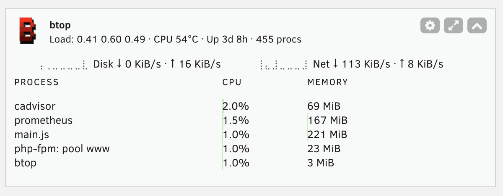

# unraid-btop

Unraid plugin for [btop](https://github.com/aristocratos/btop): the btop
resource monitor in your terminal, plus a native dashboard tile.

> **Attribution:** I am **not** the author of btop. btop is created and
> maintained by [aristocratos](https://github.com/aristocratos) and its
> contributors - all credit for the monitor itself goes to them. This
> repository is only an **Unraid integration**: it packages the official
> btop binary and adds a dashboard widget and plugin plumbing around it.
> Report btop bugs [upstream](https://github.com/aristocratos/btop/issues);
> report integration issues [here](https://github.com/Greite/unraid-btop/issues).

## Features

- **`btop` CLI** available in SSH and the Unraid web terminal, with settings
  persisted on the flash drive across reboots.
- **Dashboard tile**: load average, CPU temperature, uptime, process count,
  aggregated disk and network I/O rates, and a table of the busiest
  processes - the things the stock Unraid dashboard doesn't show. Each
  section can be toggled and tuned (sort key, row count, refresh interval)
  in Settings > User Utilities > btop.
- **Auto-updated**: CI tracks btop releases daily, rebuilds, smoke tests and
  publishes a plugin update automatically.

## Install

Unraid 6.12.0 or later, x86_64.

Plugins → Install Plugin →

    https://raw.githubusercontent.com/Greite/unraid-btop/main/btop.plg

Or search for "btop" in Community Applications (once listed).

## Notes

- Don't install alongside the NerdTools btop package - both ship `/usr/bin/btop`.
- GPU monitoring inside btop is unavailable (the static musl binary cannot
  load NVML/ROCm libraries).
- Uninstalling keeps your btop settings in `/boot/config/plugins/btop/config/`.

## Development

    bash scripts/build.sh "$(cat BTOP_VERSION)"   # build dist/unraid.btop-<date>-x86_64-1.txz
    bash scripts/test_build.sh                    # build + verify package contents
    php tests/php/run_tests.php                   # unit tests for the stats library
    bash scripts/test_php_syntax.sh               # php -l on all php/page files

Releases are fully automated: `check-btop-update.yml` (daily cron) detects new
btop releases and triggers `release.yml`, which builds, smoke tests, publishes
the GitHub Release and bumps `btop.plg` + `BTOP_VERSION` on `main`.

## Contributing

See [CONTRIBUTING.md](CONTRIBUTING.md). TL;DR: plugin/integration issues here,
btop issues upstream, and never bump `btop.plg` manually - CI owns releases.

## License

Plugin code: [MIT](LICENSE). btop itself is Apache-2.0 (its LICENSE ships in
the package at `/usr/share/btop/LICENSE`).
